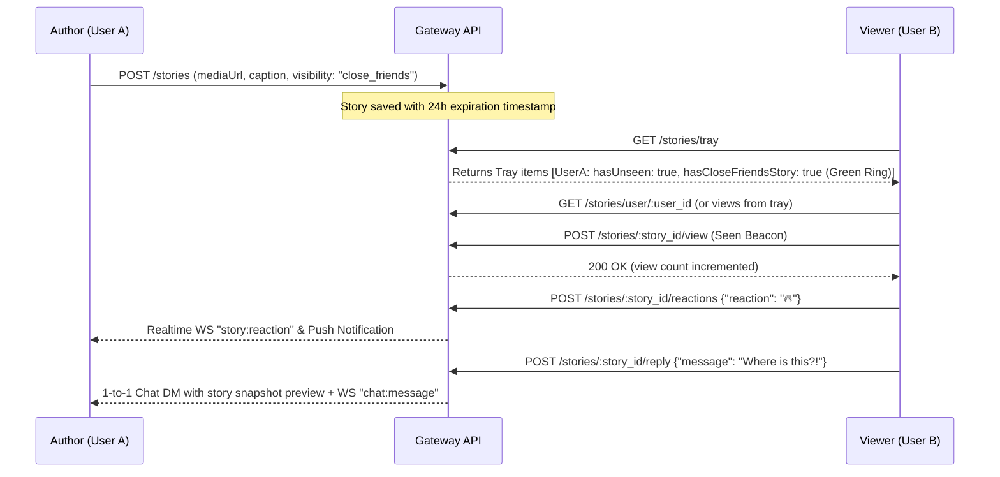
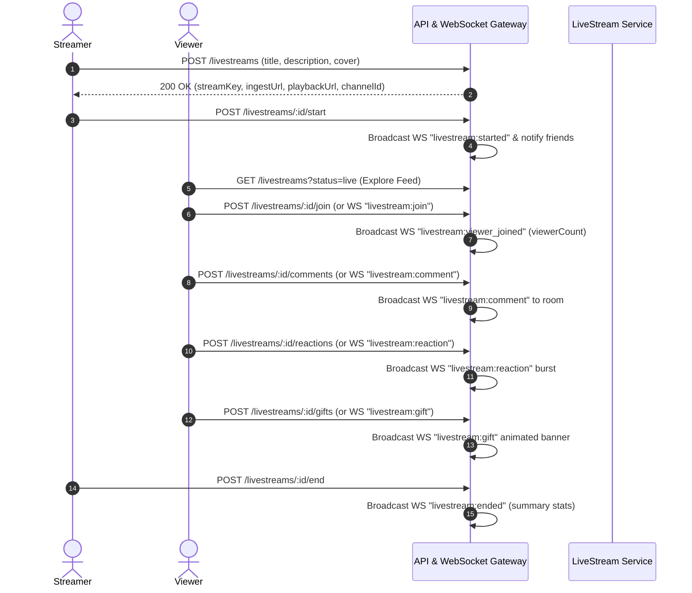
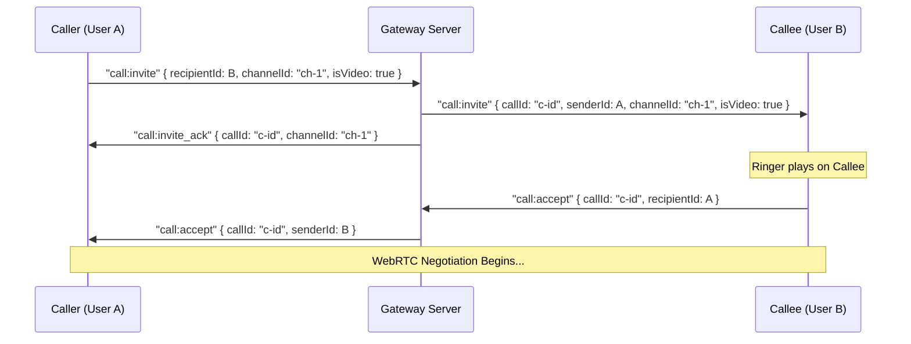

# Developer Integration Guide: Lotus Connect Chat & Signaling System

This document outlines the complete contract for communication between the Flutter client and the Axum (Rust) backend, detailing both REST API endpoints and real-time WebSocket protocol messages.

---

## 🗂️ 1. REST API Reference

All REST endpoints are prefixed with `/api/v1` and assume JSON request and response bodies unless otherwise specified.

### 🔐 Authentication

#### **Register User**
* **Endpoint**: `POST /auth/register`
* **Request Model**:
  ```json
  {
    "username": "johndoe",
    "email": "john@example.com",
    "password": "securepassword123",
    "fullName": "John Doe"
  }
  ```
* **Response Model** (200 OK / 201 Created):
  ```json
  {
    "accessToken": "eyJhbGciOi...",
    "refreshToken": "eyJhbGciOi...",
    "user": {
      "id": "019fb231-20c0-7cf1-84d5-dd053a261255",
      "username": "johndoe",
      "email": "john@example.com",
      "fullName": "John Doe",
      "avatarUrl": "http://localhost:8080/uploads/019fc877-c918-7241-94b2-298f26a57008-avatar.jpg"
    }
  }
  ```

#### **Login User**
* **Endpoint**: `POST /auth/login`
* **Request Model**:
  ```json
  {
    "username": "johndoe",
    "password": "securepassword123"
  }
  ```
* **Response Model** (200 OK): Same as Register User response.

---

### 👥 Friends & Contacts

#### **List Accepted Friends**
* **Endpoint**: `GET /users/friends`
* **Headers**: `Authorization: Bearer <access_token>`
* **Response Model** (200 OK):
  ```json
  [
    {
      "id": "019fa983-9f8c-7fc0-a285-fef0a8b88064",
      "username": "janedoe",
      "email": "jane@example.com",
      "fullName": "Jane Doe",
      "avatarUrl": "http://localhost:8080/uploads/019fa983-avatar.jpg"
    }
  ]
  ```

#### **Send Friend Request**
* **Endpoint**: `POST /users/friends`
* **Headers**: `Authorization: Bearer <access_token>`
* **Request Model**:
  ```json
  {
    "username": "janedoe"
  }
  ```
* **Response Model** (200 OK):
  ```json
  {
    "status": "success",
    "message": "Friend request sent successfully"
  }
  ```

#### **Accept Friend Request**
* **Endpoint**: `POST /users/friends/accept`
* **Headers**: `Authorization: Bearer <access_token>`
* **Request Model**:
  ```json
  {
    "friendId": "019fa983-9f8c-7fc0-a285-fef0a8b88064"
  }
  ```
* **Response Model** (200 OK):
  ```json
  {
    "success": true,
    "message": "Friend request accepted successfully"
  }
  ```

#### **Reject Pending Friend Request**
* **Endpoint**: `POST /users/friends/reject`
* **Headers**: `Authorization: Bearer <access_token>`
* **Request Model**:
  ```json
  {
    "friendId": "019fa983-9f8c-7fc0-a285-fef0a8b88064"
  }
  ```
* **Response Model** (200 OK):
  ```json
  {
    "success": true,
    "message": "Friend request rejected successfully"
  }
  ```

#### **Delete / Unfriend Friend**
* **Endpoint Option 1 (REST DELETE)**: `DELETE /users/friends/:friend_id`
* **Endpoint Option 2 (POST Remove)**: `POST /users/friends/remove`
* **Headers**: `Authorization: Bearer <access_token>`
* **Request Model (for Option 2)**:
  ```json
  {
    "friendId": "019fa983-9f8c-7fc0-a285-fef0a8b88064"
  }
  ```
* **Response Model** (200 OK):
  ```json
  {
    "success": true,
    "message": "Friend removed successfully"
  }
  ```

---

### 🔔 Notifications & Devices

#### **Get Notifications List**
* **Endpoint**: `GET /users/notifications`
* **Headers**: `Authorization: Bearer <access_token>`
* **Response Model** (200 OK):
  ```json
  [
    {
      "id": "019fb231-20c0-7cf1-84d5-dd053a261255",
      "user_id": "01a03314-af86-72f3-b270-d5642b05fbdc",
      "title": "New message from John Nguyen",
      "body": "Hello!",
      "data": null,
      "is_read": false,
      "created_at": "2026-09-03T10:00:00Z"
    }
  ]
  ```

#### **Mark All Notifications as Read**
* **Endpoint**: `POST /users/notifications/read`
* **Headers**: `Authorization: Bearer <access_token>`
* **Response Model** (200 OK):
  ```json
  {
    "success": true,
    "message": "Notifications marked as read"
  }
  ```

#### **Mark a Specific Notification as Read**
* **Endpoint**: `POST /users/notifications/:notification_id/read` *(or PATCH)*
* **Headers**: `Authorization: Bearer <access_token>`
* **Response Model** (200 OK):
  ```json
  {
    "success": true,
    "message": "Notification marked as read"
  }
  ```

#### **Delete a Specific Notification**
* **Endpoint**: `DELETE /users/notifications/:notification_id`
* **Headers**: `Authorization: Bearer <access_token>`
* **Response Model** (200 OK):
  ```json
  {
    "success": true,
    "message": "Notification deleted successfully"
  }
  ```
* **Error Responses**:
  - `401 Unauthorized`: Missing or invalid JWT
  - `404 Not Found`: Notification not found or does not belong to the authenticated user


#### **Register Device Token (Push Notifications)**
* **Endpoint**: `POST /users/devices` *(alias: `/users/device-token`)*
* **Headers**: `Authorization: Bearer <access_token>`
* **Request Model**:
  ```json
  {
    "token": "dUpAHTrbRfSwn_lEsvcYtI:APA91bGRt27bamAz02b-t_...",
    "platform": "ios"
  }
  ```
* **Response Model** (200 OK):
  ```json
  {
    "success": true,
    "message": "Device registered successfully"
  }
  ```

#### **Unregister Device Token**
* **Endpoint**: `POST /users/devices/unregister`
* **Headers**: `Authorization: Bearer <access_token>`
* **Request Model**:
  ```json
  {
    "token": "dUpAHTrbRfSwn_lEsvcYtI:APA91bGRt27bamAz02b-t_..."
  }
  ```
* **Response Model** (200 OK):
  ```json
  {
    "success": true,
    "message": "Device unregistered successfully"
  }
  ```

---

### 👤 User Profile & Avatar

#### **Get Current User Profile**
* **Endpoint**: `GET /users/me`
* **Headers**: `Authorization: Bearer <access_token>`
* **Response Model** (200 OK):
  ```json
  {
    "id": "019fb231-20c0-7cf1-84d5-dd053a261255",
    "username": "johndoe",
    "fullName": "John Doe",
    "email": "john@example.com",
    "avatarUrl": "http://localhost:8080/uploads/019fc877-c918-7241-94b2-298f26a57008-avatar.jpg",
    "friendshipStatus": null,
    "friendshipSenderId": null
  }
  ```

#### **Upload Avatar (Multipart)**
Uploads an image file for the current user's profile avatar. Supported formats include `jpg`, `jpeg`, `png`, `webp`, and `gif` (max 10MB).
* **Endpoint**: `POST /users/avatar` *(aliases: `POST /users/me/avatar`, `POST /upload/avatar`, `POST /uploads/avatar`)*
* **Headers**: `Authorization: Bearer <access_token>`, `Content-Type: multipart/form-data`
* **Form-data**: `avatar: <binary>` or `file: <binary>`
* **Response Model** (200 OK):
  ```json
  {
    "avatarUrl": "http://localhost:8080/uploads/019fc877-c918-7241-94b2-298f26a57008-avatar.jpg",
    "fileUrl": "http://localhost:8080/uploads/019fc877-c918-7241-94b2-298f26a57008-avatar.jpg",
    "user": {
      "id": "019fb231-20c0-7cf1-84d5-dd053a261255",
      "username": "johndoe",
      "fullName": "John Doe",
      "email": "john@example.com",
      "avatarUrl": "http://localhost:8080/uploads/019fc877-c918-7241-94b2-298f26a57008-avatar.jpg"
    }
  }
  ```

#### **Update Avatar URL (JSON)**
Sets or updates the current user's avatar URL using an already-uploaded file URL.
* **Endpoint**: `PUT /users/avatar` *(or `PATCH /users/avatar`, aliases: `/users/me/avatar`)*
* **Headers**: `Authorization: Bearer <access_token>`, `Content-Type: application/json`
* **Request Model**:
  ```json
  {
    "avatarUrl": "http://localhost:8080/uploads/019fc877-c918-7241-94b2-298f26a57008-avatar.jpg"
  }
  ```
* **Response Model** (200 OK): Same as Upload Avatar response.

---

### 📁 Media & File Uploads

#### **Upload Single File**
* **Endpoint**: `POST /api/v1/uploads` (or `POST /api/v1/upload`)
* **Headers**: `Authorization: Bearer <access_token>`, `Content-Type: multipart/form-data`
* **Form-data**: `file: <binary>`
* **Response Model** (200 OK):
  ```json
  {
    "fileUrl": "http://localhost:8080/uploads/019fc877-c918-7241-94b2-298f26a57008-recording.m4a"
  }
  ```

#### **Upload Multiple Files (Batch)**
* **Endpoint**: `POST /api/v1/uploads/multiple` (or `POST /api/v1/upload/multiple`)
* **Headers**: `Authorization: Bearer <access_token>`, `Content-Type: multipart/form-data`
* **Form-data**: Multiple file fields (`files`, `files[]`, or `file1`, `file2`)
* **Response Model** (200 OK):
  ```json
  {
    "files": [
      {
        "url": "http://localhost:8080/uploads/01a070af-cb79-7cc2-8395-4e64faddceea-photo1.jpg",
        "fileName": "photo1.jpg",
        "fileSize": 1542000,
        "mimeType": "image/jpeg"
      },
      {
        "url": "http://localhost:8080/uploads/01a070af-cb79-7cc2-8395-4e7054870ba4-photo2.jpg",
        "fileName": "photo2.jpg",
        "fileSize": 1820000,
        "mimeType": "image/jpeg"
      }
    ],
    "fileUrls": [
      "http://localhost:8080/uploads/01a070af-cb79-7cc2-8395-4e64faddceea-photo1.jpg",
      "http://localhost:8080/uploads/01a070af-cb79-7cc2-8395-4e7054870ba4-photo2.jpg"
    ]
  }
  ```

---

### 💬 Chats & Private Messaging

#### **Create Private Chat Conversation**
* **Endpoint**: `POST /chats/private`
* **Headers**: `Authorization: Bearer <access_token>`
* **Request Model**:
  ```json
  {
    "friendId": "019fa983-9f8c-7fc0-a285-fef0a8b88064"
  }
  ```
* **Response Model** (200 OK):
  ```json
  {
    "id": "019fc863-2500-7012-bcb9-dc61cef4c8e1",
    "title": "Jane Doe",
    "isUserToUser": true,
    "peerId": "019fa983-9f8c-7fc0-a285-fef0a8b88064",
    "createdAt": "2026-08-09T12:00:00Z"
  }
  ```

#### **Get Messages (with cursor-based pagination)**
* **Endpoint**: `GET /api/v1/chats/:conversation_id/messages`
* **Headers**: `Authorization: Bearer <access_token>`
* **Query Parameters**:
  * `cursor`: Message ID cursor for loading older messages (optional)
  * `limit`: Number of messages per page (optional, default: 25, max: 100)
* **Response Model** (200 OK, ordered chronologically ascending `created_at ASC`):
  ```json
  [
    {
      "id": "019fc863-0b31-7c43-bfb6-81f8133eacb4",
      "conversation_id": "019fc863-2500-7012-bcb9-dc61cef4c8e1",
      "sender_id": "019fb231-20c0-7cf1-84d5-dd053a261255",
      "content": "Vacation photos",
      "message_type": "image",
      "reply_to_id": null,
      "media_url": "http://localhost:8080/uploads/img-1.jpg",
      "thumbnail_url": "http://localhost:8080/uploads/img-1-thumb.jpg",
      "file_name": "photo1.jpg",
      "file_size": 1542000,
      "mime_type": "image/jpeg",
      "duration": null,
      "media_items": [
        {
          "url": "http://localhost:8080/uploads/img-1.jpg",
          "thumbnailUrl": "http://localhost:8080/uploads/img-1-thumb.jpg",
          "fileName": "photo1.jpg",
          "fileSize": 1542000,
          "mimeType": "image/jpeg",
          "duration": null,
          "width": 1080,
          "height": 720
        },
        {
          "url": "http://localhost:8080/uploads/img-2.jpg",
          "thumbnailUrl": "http://localhost:8080/uploads/img-2-thumb.jpg",
          "fileName": "photo2.jpg",
          "fileSize": 1820000,
          "mimeType": "image/jpeg",
          "duration": null,
          "width": 1080,
          "height": 720
        }
      ],
      "is_edited": false,
      "created_at": "2026-08-09T12:01:00Z",
      "updated_at": "2026-08-09T12:01:00Z",
      "reactions": [
        {
          "reaction": "👍",
          "count": 1,
          "users": ["019fb231-20c0-7cf1-84d5-dd053a261255"]
        }
      ]
    }
  ]
  ```

#### **Send Message (Text, Voice, or Multi-Media)**
* **Endpoint**: `POST /api/v1/chats/:conversation_id/messages`
* **Headers**: `Authorization: Bearer <access_token>`, `Content-Type: application/json`
* **Request Model (Multi-Image / Multi-Media)**:
  ```json
  {
    "content": "Trip photos",
    "messageType": "image",
    "mediaItems": [
      {
        "url": "http://localhost:8080/uploads/img-1.jpg",
        "thumbnailUrl": "http://localhost:8080/uploads/img-1-thumb.jpg",
        "fileName": "photo1.jpg",
        "fileSize": 1542000,
        "mimeType": "image/jpeg",
        "width": 1080,
        "height": 720
      },
      {
        "url": "http://localhost:8080/uploads/img-2.jpg",
        "thumbnailUrl": "http://localhost:8080/uploads/img-2-thumb.jpg",
        "fileName": "photo2.jpg",
        "fileSize": 1820000,
        "mimeType": "image/jpeg",
        "width": 1080,
        "height": 720
      }
    ]
  }
  ```
* **Response Model** (200 OK): Same as message object with `media_items` populated.


#### **Edit Message**
* **Endpoint**: `PUT /chats/messages/:message_id`
* **Headers**: `Authorization: Bearer <access_token>`
* **Request Model**:
  ```json
  {
    "content": "Hello Jane, how are you doing today?"
  }
  ```
* **Response Model** (200 OK):
  ```json
  {
    "id": "019fc863-0b31-7c43-bfb6-81f8133eacb4",
    "conversationId": "019fc863-2500-7012-bcb9-dc61cef4c8e1",
    "senderId": "019fb231-20c0-7cf1-84d5-dd053a261255",
    "content": "Hello Jane, how are you doing today?",
    "replyToId": null,
    "createdAt": "2026-08-09T12:01:00Z",
    "updatedAt": "2026-08-09T12:05:00Z"
  }
  ```

#### **Delete Message**
* **Endpoint**: `DELETE /chats/messages/:message_id`
* **Headers**: `Authorization: Bearer <access_token>`
* **Response Model** (200 OK):
  ```json
  {
    "status": "success"
  }
  ```

---

### 📞 Call History

#### **Get Call History List**
* **Endpoint**: `GET /calls/history`
* **Headers**: `Authorization: Bearer <access_token>`
* **Response Model** (200 OK):
  ```json
  [
    {
      "id": "019fce92-411a-7b3f-b883-fae431debcab",
      "callerId": "019fb231-20c0-7cf1-84d5-dd053a261255",
      "conversationId": "019fc863-2500-7012-bcb9-dc61cef4c8e1",
      "channelId": "call-session-987",
      "isVideo": true,
      "status": "completed",
      "createdAt": "2026-08-09T10:00:00Z",
      "duration": 180
    }
  ]
---

### 📰 Social Feed & Posts

The Social Feed API powers Facebook and Instagram-style social interactions, including multi-media rich posts, personalized timelines (friends + own posts), global explore discovery, emoji reactions, and nested comment threads.

All endpoints require `Authorization: Bearer <access_token>`.

#### **1. Create Post**
* **Endpoint**: `POST /posts`
* **Headers**: `Authorization: Bearer <access_token>`
* **Request Model**:
  ```json
  {
    "content": "Exploring the serene beauty of the countryside! 🌿✨ #travel #nature",
    "mediaItems": [
      {
        "url": "http://localhost:8080/uploads/019fd520-a75b-7589-9807-6bb9fdf7e3a9-photo.jpg",
        "mimeType": "image/jpeg",
        "width": 1080,
        "height": 1350
      },
      {
        "url": "http://localhost:8080/uploads/019fd521-b85c-7590-9908-7cc0fef8e4ba-video.mp4",
        "thumbnailUrl": "http://localhost:8080/uploads/019fd521-thumb.jpg",
        "mimeType": "video/mp4",
        "duration": 45
      }
    ],
    "visibility": "public" // 'public', 'friends', or 'private' (default: 'public')
  }
  ```
* **Response Model** (200 OK):
  ```json
  {
    "id": "019fd530-8a12-70b1-8b01-f2d47e8e29ba",
    "author": {
      "id": "019fb231-20c0-7cf1-84d5-dd053a261255",
      "username": "johndoe",
      "fullName": "John Doe",
      "avatarUrl": "http://localhost:8080/uploads/avatar.jpg"
    },
    "content": "Exploring the serene beauty of the countryside! 🌿✨ #travel #nature",
    "mediaItems": [
      {
        "url": "http://localhost:8080/uploads/019fd520-a75b-7589-9807-6bb9fdf7e3a9-photo.jpg",
        "mimeType": "image/jpeg",
        "width": 1080,
        "height": 1350
      }
    ],
    "visibility": "public",
    "likeCount": 0,
    "commentCount": 0,
    "userHasLiked": false,
    "userReaction": null,
    "createdAt": "2026-09-18T14:30:00Z",
    "updatedAt": "2026-09-18T14:30:00Z"
  }
  ```

#### **2. Get Post Details**
* **Endpoint**: `GET /posts/:post_id`
* **Headers**: `Authorization: Bearer <access_token>`
* **Response Model** (200 OK): Returns `PostResponse` object (same as Create Post).

#### **3. Update Post**
* **Endpoint**: `PUT /posts/:post_id` *(or `PATCH /posts/:post_id`)*
* **Headers**: `Authorization: Bearer <access_token>`
* **Request Model**:
  ```json
  {
    "content": "Updated caption for the post! 🌸",
    "visibility": "friends"
  }
  ```
* **Response Model** (200 OK): Returns updated `PostResponse`.

#### **4. Delete Post**
* **Endpoint**: `DELETE /posts/:post_id`
* **Headers**: `Authorization: Bearer <access_token>`
* **Response Model** (200 OK):
  ```json
  {
    "success": true,
    "message": "Post deleted successfully"
  }
  ```

#### **5. Get Home Feed (Personalized Timeline)**
Returns posts from the authenticated user, their accepted friends, and public posts, ordered by newest first with cursor-based pagination.
* **Endpoint**: `GET /feed?cursor=<post_uuid>&limit=<limit>`
* **Headers**: `Authorization: Bearer <access_token>`
* **Query Parameters**:
  * `cursor` *(optional, UUID)*: The `id` of the last post loaded in the current page.
  * `limit` *(optional, integer)*: Default `20`, min `1`, max `50`.
* **Response Model** (200 OK): Array of `PostResponse` objects.

#### **6. Get Explore Feed (Global Discovery)**
Returns all public posts platform-wide, ideal for discovery (Instagram Explore style).
* **Endpoint**: `GET /feed/explore?cursor=<post_uuid>&limit=<limit>`
* **Headers**: `Authorization: Bearer <access_token>`
* **Response Model** (200 OK): Array of `PostResponse` objects.

#### **7. Get User Profile Feed**
Returns posts authored by a specific user. Visibility is automatically enforced based on the relationship with the viewer (self sees all, friends see public + friends, non-friends see public only).
* **Endpoint**: `GET /users/:user_id/posts?cursor=<post_uuid>&limit=<limit>`
* **Headers**: `Authorization: Bearer <access_token>`
* **Response Model** (200 OK): Array of `PostResponse` objects.

#### **8. Add / Toggle Post Reaction**
* **Endpoint**: `POST /posts/:post_id/reactions`
* **Headers**: `Authorization: Bearer <access_token>`
* **Request Model**:
  ```json
  {
    "reaction": "love" // 'like', 'love', 'haha', 'wow', 'sad', 'angry' (default: 'like')
  }
  ```
* **Response Model** (200 OK):
  ```json
  {
    "id": "019fd535-645b-7489-9801-112233445566",
    "postId": "019fd530-8a12-70b1-8b01-f2d47e8e29ba",
    "user": {
      "id": "019fb231-20c0-7cf1-84d5-dd053a261255",
      "username": "janedoe",
      "fullName": "Jane Doe",
      "avatarUrl": "http://localhost:8080/uploads/jane.jpg"
    },
    "reaction": "love",
    "createdAt": "2026-09-18T14:35:00Z"
  }
  ```

#### **9. Remove Post Reaction**
* **Endpoint**: `DELETE /posts/:post_id/reactions`
* **Headers**: `Authorization: Bearer <access_token>`
* **Response Model** (200 OK):
  ```json
  {
    "success": true,
    "message": "Reaction removed successfully"
  }
  ```

#### **10. List Post Reactions**
* **Endpoint**: `GET /posts/:post_id/reactions`
* **Headers**: `Authorization: Bearer <access_token>`
* **Response Model** (200 OK): Array of reaction detail objects.

#### **11. Add Comment (or Reply to Comment)**
Adds a top-level comment or a threaded reply to a post (supporting media attachments like stickers/GIFs/images), replying to an existing reply automatically threads under the root comment in a clean 2-tier conversation. Dispatches a real-time `comment:created` WebSocket event and push notifications to the post author (and to the parent comment author if replying).
* **Endpoint**: `POST /posts/:post_id/comments`
* **Headers**: `Authorization: Bearer <access_token>`
* **Request Model**:
  ```json
  {
    "content": "This looks incredible! Where was this taken? 🎉",
    "parentCommentId": null, // UUID of parent comment for threaded replies (or null for root comment)
    "mediaUrl": "http://localhost:8080/uploads/stickers/party.gif" // Optional sticker/GIF/image attachment
  }
  ```
* **Response Model** (200 OK):
  ```json
  {
    "id": "019fd540-1234-7589-9807-aabbccddeeff",
    "postId": "019fd530-8a12-70b1-8b01-f2d47e8e29ba",
    "author": {
      "id": "019fa983-9f8c-7fc0-a285-fef0a8b88064",
      "username": "janedoe",
      "fullName": "Jane Doe",
      "avatarUrl": "http://localhost:8080/uploads/jane.jpg"
    },
    "parentCommentId": null,
    "content": "This looks incredible! Where was this taken? 🎉",
    "mediaUrl": "http://localhost:8080/uploads/stickers/party.gif",
    "likeCount": 0,
    "replyCount": 0,
    "isPinned": false,
    "pinnedAt": null,
    "userHasLiked": false,
    "userReaction": null,
    "createdAt": "2026-09-18T14:40:00Z",
    "updatedAt": "2026-09-18T14:40:00Z"
  }
  ```

#### **12. Get Post Top-Level Comments**
Fetches paginated top-level comments for a post. Pinned comments appear prominently at the top.
* **Endpoint**: `GET /posts/:post_id/comments?cursor=<uuid>&limit=<number>&sort=<popular|newest|oldest>`
* **Headers**: `Authorization: Bearer <access_token>`
* **Query Parameters**:
  * `cursor` (UUID, optional): Cursor for infinite scrolling.
  * `limit` (integer, optional, default: 20, max: 50): Number of items per page.
  * `sort` (string, optional, default: `"popular"`): `"popular"` (most liked), `"newest"` (most recent), or `"oldest"`.
* **Response Model** (200 OK): Array of `CommentResponse` objects.

#### **13. Get Threaded Replies for a Comment**
Fetches paginated replies belonging to a specific parent comment, ordered chronologically (earliest to latest).
* **Endpoints**: 
  * `GET /posts/:post_id/comments/:comment_id/replies?cursor=<uuid>&limit=<number>`
  * `GET /comments/:comment_id/replies?cursor=<uuid>&limit=<number>`
* **Headers**: `Authorization: Bearer <access_token>`
* **Response Model** (200 OK): Array of `CommentResponse` objects.

#### **14. Update Comment**
Allows the comment author to edit their comment content and media attachment. Dispatches a real-time `comment:updated` WebSocket event.
* **Endpoints**:
  * `PUT /posts/:post_id/comments/:comment_id` (or `PATCH`)
  * `PUT /comments/:comment_id` (or `PATCH`)
* **Headers**: `Authorization: Bearer <access_token>`
* **Request Model**:
  ```json
  {
    "content": "Updated comment text! ✨",
    "mediaUrl": null
  }
  ```
* **Response Model** (200 OK): `CommentResponse` object.

#### **15. Delete Comment**
Deletes a comment. Authorized for the **comment author** OR the **post author** (creator moderation). Deleting a parent comment cascades to all threaded replies and atomically decrements both `comment_count` and parent `reply_count`. Dispatches a real-time `comment:deleted` WebSocket event.
* **Endpoints**:
  * `DELETE /posts/:post_id/comments/:comment_id`
  * `DELETE /comments/:comment_id`
* **Headers**: `Authorization: Bearer <access_token>`
* **Response Model** (200 OK):
  ```json
  {
    "success": true,
    "message": "Comment deleted successfully"
  }
  ```

#### **16. Add / Update Comment Reaction (Like / Heart)**
Reactions (likes/hearts) on comments similar to Facebook, Instagram, and TikTok. Dispatches a real-time `comment:reaction` WebSocket event and push notification to the comment author.
* **Endpoints**:
  * `POST /posts/:post_id/comments/:comment_id/reactions`
  * `POST /comments/:comment_id/reactions`
* **Headers**: `Authorization: Bearer <access_token>`
* **Request Model**:
  ```json
  {
    "reaction": "❤️" // Defaults to "like" if omitted; accepts emojis or strings: 'like', '❤️', '🔥', '😂'
  }
  ```
* **Response Model** (200 OK):
  ```json
  {
    "id": "019fd560-1111-7222-9333-aabbccddeeff",
    "commentId": "019fd540-1234-7589-9807-aabbccddeeff",
    "user": {
      "id": "019fa983-9f8c-7fc0-a285-fef0a8b88064",
      "username": "janedoe",
      "fullName": "Jane Doe",
      "avatarUrl": "http://localhost:8080/uploads/jane.jpg"
    },
    "reaction": "❤️",
    "createdAt": "2026-09-18T14:45:00Z"
  }
  ```

#### **17. Remove Comment Reaction**
* **Endpoints**:
  * `DELETE /posts/:post_id/comments/:comment_id/reactions`
  * `DELETE /comments/:comment_id/reactions`
* **Headers**: `Authorization: Bearer <access_token>`
* **Response Model** (200 OK):
  ```json
  {
    "success": true,
    "message": "Reaction removed successfully"
  }
  ```

#### **18. List Comment Reactions**
* **Endpoints**:
  * `GET /posts/:post_id/comments/:comment_id/reactions`
  * `GET /comments/:comment_id/reactions`
* **Headers**: `Authorization: Bearer <access_token>`
* **Response Model** (200 OK): Array of `CommentReactionResponse` objects.

#### **19. Pin / Unpin Comment (Creator Highlight)**
Post authors can pin up to 1 top-level comment to feature it prominently at the top of the post (just like on Instagram and TikTok). Dispatches a real-time `comment:pinned` WebSocket event and notifies the comment author.
* **Endpoints**:
  * Pin: `POST /posts/:post_id/comments/:comment_id/pin` (or `POST /comments/:comment_id/pin`)
  * Unpin: `DELETE /posts/:post_id/comments/:comment_id/pin` (or `DELETE /comments/:comment_id/pin`)
* **Headers**: `Authorization: Bearer <access_token>`
* **Response Model** (200 OK):
  ```json
  {
    "success": true,
    "message": "Comment pinned successfully" // or "Comment unpinned successfully"
  }
  ```

---

### 📸 Ephemeral Stories (Instagram Style)

The Stories API provides an Instagram-grade story experience featuring 24-hour ephemerality, rich media overlays, personalized Close Friends privacy (with iconic green-ring badges), interactive seen tracking, quick emoji reactions, and direct chat replies.

All endpoints require `Authorization: Bearer <access_token>`.

#### **1. Story Lifecycle & Architecture Flow**



---

#### **2. Create Story**
Publishes an image, video, or text story expiring automatically in 24 hours.
* **Endpoint**: `POST /stories`
* **Headers**: `Authorization: Bearer <access_token>`
* **Request Model**:
  ```json
  {
    "mediaType": "image", // 'image', 'video', or 'text' (default: 'image')
    "mediaUrl": "http://localhost:8080/uploads/019fd520-a75b-story.jpg",
    "thumbnailUrl": "http://localhost:8080/uploads/019fd520-thumb.jpg", // optional (for video)
    "caption": "Sunset golden hour at the beach! 🌅✨", // optional
    "duration": 5.0, // seconds to display (default: 5.0 for photos, up to 60.0 for videos)
    "visibility": "friends", // 'public', 'friends' (all accepted friends), or 'close_friends' (only friends in Close Friends list)
    "backgroundColor": "#1A1A24", // optional background color / gradient hex code
    "metadata": { // optional rich metadata for stickers, tags, coordinates
      "stickers": [
        { "type": "location", "name": "Da Nang, Vietnam", "lat": 16.0544, "lng": 108.2022 },
        { "type": "mention", "username": "janedoe" }
      ]
    }
  }
  ```
* **Response Model** (200 OK / 201 Created):
  ```json
  {
    "id": "019fe120-7b23-7fa1-92b3-5511aa223344",
    "author": {
      "id": "019fb231-20c0-7cf1-84d5-dd053a261255",
      "username": "johndoe",
      "fullName": "John Doe",
      "avatarUrl": "http://localhost:8080/uploads/avatar.jpg"
    },
    "mediaType": "image",
    "mediaUrl": "http://localhost:8080/uploads/019fd520-a75b-story.jpg",
    "thumbnailUrl": "http://localhost:8080/uploads/019fd520-thumb.jpg",
    "caption": "Sunset golden hour at the beach! 🌅✨",
    "duration": 5.0,
    "visibility": "close_friends",
    "backgroundColor": "#1A1A24",
    "metadata": { ... },
    "createdAt": "2026-09-28T10:00:00Z",
    "expiresAt": "2026-09-29T10:00:00Z",
    "viewCount": 0,
    "hasViewed": false,
    "viewerReaction": null,
    "isCloseFriend": true
  }
  ```

---

#### **3. Get Stories Tray / Feed (Instagram Top Bar)**
Powers the horizontal story tray at the top of the app feed.
* **Endpoint**: `GET /stories/tray` *(or alias `GET /stories/feed`)*
* **Headers**: `Authorization: Bearer <access_token>`
* **Tray Sorting Order**:
  1. The authenticated user's own active stories (`isSelf: true`) appear first.
  2. Friends with unseen stories (`hasUnseen: true`), sorted by newest story first.
  3. Friends whose stories have all been watched (`hasUnseen: false`), sorted by newest story first.
* **UI Indicator Flags**:
  * `hasUnseen: true`: Display colorful Instagram gradient ring around avatar.
  * `hasCloseFriendsStory: true`: Display iconic green ring around avatar.
* **Response Model** (200 OK):
  ```json
  [
    {
      "user": {
        "id": "019fb231-20c0-7cf1-84d5-dd053a261255",
        "username": "johndoe",
        "fullName": "John Doe",
        "avatarUrl": "http://localhost:8080/uploads/john.jpg"
      },
      "stories": [
        {
          "id": "019fe120-7b23-7fa1-92b3-5511aa223344",
          "author": { ... },
          "mediaType": "image",
          "mediaUrl": "http://localhost:8080/uploads/story1.jpg",
          "duration": 5.0,
          "visibility": "friends",
          "viewCount": 8,
          "hasViewed": true,
          "viewerReaction": null,
          "isCloseFriend": true,
          "createdAt": "2026-09-28T08:30:00Z",
          "expiresAt": "2026-09-29T08:30:00Z"
        }
      ],
      "hasUnseen": false,
      "totalStories": 1,
      "latestStoryCreatedAt": "2026-09-28T08:30:00Z",
      "hasCloseFriendsStory": false,
      "isSelf": true
    },
    {
      "user": {
        "id": "019fa983-9f8c-7fc0-a285-fef0a8b88064",
        "username": "janedoe",
        "fullName": "Jane Doe",
        "avatarUrl": "http://localhost:8080/uploads/jane.jpg"
      },
      "stories": [
        {
          "id": "019fe125-11aa-7fc2-b883-fae431debcab",
          "author": { ... },
          "mediaType": "image",
          "mediaUrl": "http://localhost:8080/uploads/jane_story.jpg",
          "duration": 5.0,
          "visibility": "close_friends",
          "viewCount": 3,
          "hasViewed": false,
          "viewerReaction": null,
          "isCloseFriend": true,
          "createdAt": "2026-09-28T09:15:00Z",
          "expiresAt": "2026-09-29T09:15:00Z"
        }
      ],
      "hasUnseen": true,
      "totalStories": 1,
      "latestStoryCreatedAt": "2026-09-28T09:15:00Z",
      "hasCloseFriendsStory": true,
      "isSelf": false
    }
  ]
  ```

---

#### **4. Get User Stories**
Returns all active stories for a specific user, filtered according to privacy permissions (viewer must be friend or close friend if restricted).
* **Endpoint**: `GET /stories/user/:user_id`
* **Headers**: `Authorization: Bearer <access_token>`
* **Response Model** (200 OK): Array of `StoryResponse` objects in chronological order.

---

#### **5. Get My Active Stories**
Returns the authenticated user's currently active stories with real-time view counts and stats.
* **Endpoint**: `GET /stories/me`
* **Headers**: `Authorization: Bearer <access_token>`
* **Response Model** (200 OK): Array of `StoryResponse` objects.

---

#### **6. Get My Archived Stories (Story Archive)**
Returns past expired stories authored by the authenticated user with pagination.
* **Endpoint**: `GET /stories/archive?cursor=<story_uuid>&limit=<limit>`
* **Headers**: `Authorization: Bearer <access_token>`
* **Query Parameters**:
  * `cursor` *(optional, UUID)*: The `id` of the last story loaded.
  * `limit` *(optional, integer)*: Default `20`, min `1`, max `50`.
* **Response Model** (200 OK): Array of `StoryResponse` objects.

---

#### **7. Get Single Story Details**
* **Endpoint**: `GET /stories/:story_id`
* **Headers**: `Authorization: Bearer <access_token>`
* **Response Model** (200 OK): `StoryResponse` object.

---

#### **8. Delete Story**
Permanently removes a story before the 24-hour expiration window closes.
* **Endpoint**: `DELETE /stories/:story_id`
* **Headers**: `Authorization: Bearer <access_token>`
* **Response Model** (200 OK):
  ```json
  {
    "success": true,
    "message": "Story deleted successfully"
  }
  ```

---

#### **9. Mark Story as Viewed (Seen Beacon)**
Sent by the client when a story begins playing. Updates seen status idempotently and increments viewer metrics.
* **Endpoint**: `POST /stories/:story_id/view` *(or alias `POST /stories/:story_id/seen`)*
* **Headers**: `Authorization: Bearer <access_token>`
* **Response Model** (200 OK):
  ```json
  {
    "success": true,
    "message": "Story marked as viewed"
  }
  ```

---

#### **10. Get Story Viewers (Author Drawer)**
Returns the complete list of users who watched the story, including timestamp and their quick reaction if any. Only accessible by the story author.
* **Endpoint**: `GET /stories/:story_id/viewers`
* **Headers**: `Authorization: Bearer <access_token>`
* **Response Model** (200 OK):
  ```json
  [
    {
      "id": "019fe130-99aa-7821-bb11-9876543210ab",
      "viewer": {
        "id": "019fa983-9f8c-7fc0-a285-fef0a8b88064",
        "username": "janedoe",
        "fullName": "Jane Doe",
        "avatarUrl": "http://localhost:8080/uploads/jane.jpg"
      },
      "viewedAt": "2026-09-28T09:45:00Z",
      "reaction": "🔥"
    }
  ]
  ```

---

#### **11. Send Quick Reaction**
Sends an emoji reaction to the story (e.g. `❤️`, `🔥`, `😂`, `😮`, `😢`, `👏`). Dispatches a real-time `story:reaction` WebSocket event and push notification to the author.
* **Endpoint**: `POST /stories/:story_id/reactions`
* **Headers**: `Authorization: Bearer <access_token>`
* **Request Model**:
  ```json
  {
    "reaction": "🔥" // defaults to '❤️' if omitted
  }
  ```
* **Response Model** (200 OK):
  ```json
  {
    "id": "019fe135-22bb-7733-8844-010203040506",
    "storyId": "019fe120-7b23-7fa1-92b3-5511aa223344",
    "user": {
      "id": "019fb231-20c0-7cf1-84d5-dd053a261255",
      "username": "johndoe",
      "fullName": "John Doe",
      "avatarUrl": "http://localhost:8080/uploads/john.jpg"
    },
    "reaction": "🔥",
    "createdAt": "2026-09-28T10:05:00Z"
  }
  ```

---

#### **12. Remove Quick Reaction**
* **Endpoint**: `DELETE /stories/:story_id/reactions`
* **Headers**: `Authorization: Bearer <access_token>`
* **Response Model** (200 OK):
  ```json
  {
    "success": true,
    "message": "Reaction removed successfully"
  }
  ```

---

#### **13. Reply to Story (Direct Chat Message)**
Sends a direct text message in response to a story. Automatically locates or creates a private 1-to-1 conversation between viewer and story author, posts a message with story snapshot preview, and triggers real-time WebSocket delivery and push notifications.
* **Endpoint**: `POST /stories/:story_id/reply`
* **Headers**: `Authorization: Bearer <access_token>`
* **Request Model**:
  ```json
  {
    "message": "This looks awesome! What camera did you use? 📸"
  }
  ```
* **Response Model** (200 OK):
  ```json
  {
    "success": true,
    "message": "Story reply sent successfully",
    "conversationId": "019fc863-2500-7012-bcb9-dc61cef4c8e1",
    "messageId": "019fe140-55cc-7011-aa99-1234567890ab"
  }
  ```

---

#### **14. Close Friends List Management**
Allows users to maintain their private Close Friends list for restricted story sharing.
* **List Close Friends**: `GET /users/close-friends` *(or `GET /stories/close-friends`)*
  * **Response Model** (200 OK):
    ```json
    [
      {
        "id": "019fe145-33dd-7711-bbaa-556677889900",
        "friend": {
          "id": "019fa983-9f8c-7fc0-a285-fef0a8b88064",
          "username": "janedoe",
          "fullName": "Jane Doe",
          "avatarUrl": "http://localhost:8080/uploads/jane.jpg"
        },
        "createdAt": "2026-09-25T14:20:00Z"
      }
    ]
    ```
* **Add Close Friend**: `POST /users/close-friends` *(or `POST /stories/close-friends`)*
  * **Request Model**:
    ```json
    {
      "friendId": "019fa983-9f8c-7fc0-a285-fef0a8b88064"
    }
    ```
  * **Response Model** (200 OK):
    ```json
    {
      "success": true,
      "message": "Close friend added successfully"
    }
    ```
* **Remove Close Friend**: `DELETE /users/close-friends/:friend_id` *(or `DELETE /stories/close-friends/:friend_id`)*
  * **Response Model** (200 OK):
    ```json
    {
      "success": true,
      "message": "Close friend removed successfully"
    }
    ```

---

### 🔴 Live Streaming (TikTok, YouTube & Facebook Style)

The Live Streaming API powers an interactive broadcasting experience similar to TikTok Live, YouTube Live, and Facebook Watch Live. Features include:
* **Lifecycle Management**: Stream creation, RTMP/WHIP ingest key generation, Go-Live status transitions, and ending with summary metrics (peak viewers, duration, likes, gifts).
* **Real-time Live Chat**: Fast live comments with broadcaster comment pinning (SuperChat/highlight style).
* **Floating Hearts & Likes**: Tap-to-like burst reactions incrementing stream counters in real time.
* **Virtual Gifts & SuperChats**: Coin-valued animated gifts (Rose, Heart, Diamond, Rocket, Crown) with live supporter leaderboard.
* **Co-Hosting & Multi-Guest (PK Battles)**: Request and accept co-streaming sessions with low-latency WebRTC interactive tiles.

#### **Live Streaming Flow**



---

#### **1. Create Live Stream**
Initializes a new live stream session and generates secure ingest credentials.
* **Endpoint**: `POST /livestreams`
* **Headers**: `Authorization: Bearer <access_token>`
* **Request Model**:
  ```json
  {
    "title": "Acoustic Night & Q&A 🎸✨",
    "description": "Playing songs and chatting with viewers!",
    "thumbnailUrl": "http://localhost:8080/uploads/live-thumb.jpg",
    "privacy": "public" // 'public', 'friends', 'private'
  }
  ```
* **Response Model** (200 OK):
  ```json
  {
    "id": "019fd810-74a0-7112-9840-001122334455",
    "host": {
      "id": "019fa983-9f8c-7fc0-a285-fef0a8b88064",
      "username": "janedoe",
      "fullName": "Jane Doe",
      "avatarUrl": "http://localhost:8080/uploads/jane.jpg"
    },
    "title": "Acoustic Night & Q&A 🎸✨",
    "description": "Playing songs and chatting with viewers!",
    "thumbnailUrl": "http://localhost:8080/uploads/live-thumb.jpg",
    "status": "created",
    "privacy": "public",
    "playbackUrl": "http://localhost:8080/api/v1/livestreams/019fd810-74a0-7112-9840-001122334455/play.m3u8",
    "channelId": "live-room-019fd810-74a0-7112-9840-001122334455",
    "viewerCount": 0,
    "peakViewers": 0,
    "totalViews": 0,
    "likeCount": 0,
    "pinnedCommentId": null,
    "startedAt": null,
    "endedAt": null,
    "durationSeconds": 0,
    "recordingUrl": null,
    "isHost": true,
    "streamKey": "live_sk_a8f9c1b2d3e4f50123456789", // Secret: only visible to host
    "ingestUrl": "rtmp://localhost:8080/live/live_sk_a8f9c1b2d3e4f50123456789",
    "createdAt": "2026-10-10T10:00:00Z",
    "updatedAt": "2026-10-10T10:00:00Z"
  }
  ```

#### **2. Get Live Stream Details**
Retrieves stream metadata and current stats. Host receives `streamKey` and `ingestUrl`; viewers receive sanitized details.
* **Endpoint**: `GET /livestreams/:id`
* **Headers**: `Authorization: Bearer <access_token>`
* **Response Model** (200 OK): Same as `CreateLiveStreamRequest` response model (`streamKey` omitted for non-hosts).

#### **3. Update Live Stream**
Updates stream title, description, or thumbnail.
* **Endpoint**: `PATCH /livestreams/:id` *(or `PUT /livestreams/:id`)*
* **Headers**: `Authorization: Bearer <access_token>`
* **Request Model**:
  ```json
  {
    "title": "Acoustic Night [Requests Open] 🎸✨",
    "description": "Now taking song requests in chat!"
  }
  ```
* **Response Model** (200 OK): Updated stream object.

#### **4. Start Live Stream (Go Live)**
Transitions the stream to `"live"`, records `startedAt`, dispatches `livestream:started` WebSocket event, and pushes notifications to followers.
* **Endpoint**: `POST /livestreams/:id/start`
* **Headers**: `Authorization: Bearer <access_token>`
* **Response Model** (200 OK): Stream object with `status: "live"`.

#### **5. End Live Stream**
Concludes the stream, resets active viewers to 0, computes duration, sets `endedAt`, attaches optional recording/VOD URL, and broadcasts summary stats.
* **Endpoint**: `POST /livestreams/:id/end`
* **Headers**: `Authorization: Bearer <access_token>`
* **Request Model**:
  ```json
  {
    "recordingUrl": "http://localhost:8080/uploads/recordings/live-019fd810.mp4"
  }
  ```
* **Response Model** (200 OK): Stream object with `status: "ended"`.

#### **6. List / Explore Live Streams**
Fetches active streams for the "Live" discovery feed (TikTok Live tab / YouTube Live feed).
* **Endpoint**: `GET /livestreams?status=<live|ended|all>&cursor=<uuid>&limit=<number>`
* **Headers**: `Authorization: Bearer <access_token>`
* **Query Parameters**:
  * `status` (string, optional, default: `"live"`): `"live"`, `"ended"`, or `"all"`.
  * `cursor` (UUID, optional): Cursor for pagination.
  * `limit` (integer, optional, default: 20, max: 50).
* **Response Model** (200 OK): Array of stream objects.

#### **7. Get My Streams**
Returns streams created by the authenticated user.
* **Endpoint**: `GET /livestreams/me?cursor=<uuid>&limit=<number>`
* **Headers**: `Authorization: Bearer <access_token>`
* **Response Model** (200 OK): Array of stream objects.

#### **8. Join Live Stream Room**
Registers the user as an active viewer, increments current viewer count, and broadcasts `livestream:viewer_joined`.
* **Endpoint**: `POST /livestreams/:id/join`
* **Headers**: `Authorization: Bearer <access_token>`
* **Response Model** (200 OK):
  ```json
  {
    "id": "019fd820-1111-7222-8333-444455556666",
    "user": {
      "id": "019fb231-20c0-7cf1-84d5-dd053a261255",
      "username": "alex",
      "fullName": "Alex Mercer",
      "avatarUrl": "http://localhost:8080/uploads/alex.jpg"
    },
    "joinedAt": "2026-10-10T10:05:00Z",
    "isActive": true
  }
  ```

#### **9. Leave Live Stream Room**
Deregisters the active viewer, decrements viewer count, and broadcasts `livestream:viewer_left`.
* **Endpoint**: `POST /livestreams/:id/leave`
* **Headers**: `Authorization: Bearer <access_token>`
* **Response Model** (200 OK):
  ```json
  {
    "success": true,
    "message": "Left live stream"
  }
  ```

#### **10. List Active Viewers**
Returns currently active viewers in the stream room.
* **Endpoint**: `GET /livestreams/:id/viewers?limit=<number>`
* **Headers**: `Authorization: Bearer <access_token>`
* **Response Model** (200 OK): Array of viewer objects with user avatars.

#### **11. Send Live Comment**
Sends a real-time live chat message, broadcasting `livestream:comment` to all viewers in the room.
* **Endpoint**: `POST /livestreams/:id/comments`
* **Headers**: `Authorization: Bearer <access_token>`
* **Request Model**:
  ```json
  {
    "content": "Can you play Wonderwall next? 🎶"
  }
  ```
* **Response Model** (200 OK):
  ```json
  {
    "id": "019fd830-5555-7666-8777-888899990000",
    "streamId": "019fd810-74a0-7112-9840-001122334455",
    "user": {
      "id": "019fb231-20c0-7cf1-84d5-dd053a261255",
      "username": "alex",
      "fullName": "Alex Mercer",
      "avatarUrl": "http://localhost:8080/uploads/alex.jpg"
    },
    "content": "Can you play Wonderwall next? 🎶",
    "isPinned": false,
    "createdAt": "2026-10-10T10:06:00Z"
  }
  ```

#### **12. List Live Comments**
Fetches chronological chat history for the stream.
* **Endpoint**: `GET /livestreams/:id/comments?cursor=<uuid>&limit=<number>`
* **Headers**: `Authorization: Bearer <access_token>`
* **Response Model** (200 OK): Array of live comment objects.

#### **13. Pin / Unpin Live Comment**
Allows the stream host to pin an announcement or highlight message at the top of the chat (TikTok / YouTube SuperChat style).
* **Pin Endpoint**: `POST /livestreams/:id/comments/:comment_id/pin`
* **Unpin Endpoint**: `DELETE /livestreams/:id/comments/:comment_id/pin`
* **Headers**: `Authorization: Bearer <access_token>`
* **Response Model** (200 OK):
  ```json
  {
    "success": true,
    "message": "Comment pinned successfully"
  }
  ```

#### **14. Send Floating Hearts / Burst Reactions**
Sends rapid tap-to-like reactions, updating total like count and broadcasting floating heart bursts.
* **Endpoint**: `POST /livestreams/:id/reactions`
* **Headers**: `Authorization: Bearer <access_token>`
* **Request Model**:
  ```json
  {
    "reaction": "heart", // 'heart', 'like', 'fire', 'star'
    "count": 10 // Rapid burst tap count (1-50)
  }
  ```
* **Response Model** (200 OK):
  ```json
  {
    "streamId": "019fd810-74a0-7112-9840-001122334455",
    "user": {
      "id": "019fb231-20c0-7cf1-84d5-dd053a261255",
      "username": "alex",
      "fullName": "Alex Mercer",
      "avatarUrl": "http://localhost:8080/uploads/alex.jpg"
    },
    "reaction": "heart",
    "count": 10,
    "totalLikes": 150
  }
  ```

#### **15. Send Virtual Gift**
Sends an animated virtual gift to the streamer (TikTok Gifts / Facebook Stars style).
* **Endpoint**: `POST /livestreams/:id/gifts`
* **Headers**: `Authorization: Bearer <access_token>`
* **Supported Gift Types**:
  * `rose` (1 coin)
  * `heart` (5 coins)
  * `coffee` (10 coins)
  * `diamond` (50 coins)
  * `firework` (100 coins)
  * `rocket` (500 coins)
  * `crown` (1000 coins)
* **Request Model**:
  ```json
  {
    "giftType": "rocket",
    "count": 1
  }
  ```
* **Response Model** (200 OK):
  ```json
  {
    "id": "019fd840-9999-7000-8111-222233334444",
    "streamId": "019fd810-74a0-7112-9840-001122334455",
    "sender": {
      "id": "019fb231-20c0-7cf1-84d5-dd053a261255",
      "username": "alex",
      "fullName": "Alex Mercer",
      "avatarUrl": "http://localhost:8080/uploads/alex.jpg"
    },
    "giftType": "rocket",
    "giftCount": 1,
    "coinAmount": 500,
    "comboCount": 1,
    "createdAt": "2026-10-10T10:08:00Z"
  }
  ```

#### **16. Get Top Supporters Leaderboard**
Returns top contributing gifters during the live stream session.
* **Endpoint**: `GET /livestreams/:id/leaderboard`
* **Headers**: `Authorization: Bearer <access_token>`
* **Response Model** (200 OK):
  ```json
  {
    "streamId": "019fd810-74a0-7112-9840-001122334455",
    "supporters": [
      {
        "user": {
          "id": "019fb231-20c0-7cf1-84d5-dd053a261255",
          "username": "alex",
          "fullName": "Alex Mercer",
          "avatarUrl": "http://localhost:8080/uploads/alex.jpg"
        },
        "totalCoins": 500,
        "giftCount": 1
      }
    ]
  }
  ```

#### **17. Request & Manage Co-Hosting (PK Battles / Multi-Guest)**
Allows a viewer to request to join the host as a co-streamer.
* **Request Co-Host**: `POST /livestreams/:id/cohost/request`
* **Respond to Request (Host only)**: `POST /livestreams/:id/cohost/respond`
  ```json
  {
    "userId": "019fb231-20c0-7cf1-84d5-dd053a261255",
    "action": "accept" // 'accept' or 'reject'
  }
  ```
* **Leave Co-Host**: `POST /livestreams/:id/cohost/leave`
* **List Active Co-Hosts**: `GET /livestreams/:id/cohosts`

---


## 🔌 2. WebSocket Protocol Schema

WebSocket endpoints require query-parameter-based JWT authentication (`/ws?token=<token>`). WebSocket message envelopes use a consistent structure:

```json
{
  "event": "event_name",
  "payload": { ... }
}
```

### 📤 Client-to-Server Events

#### **Heartbeat (Online Presence)**
Keep-alive ping sent periodically by the client.
```json
{
  "event": "heartbeat",
  "payload": {}
}
```

#### **Chat Focus**
Informs the server that the user is currently viewing a specific conversation, preventing redundant push notifications.
```json
{
  "event": "chat:focus",
  "payload": {
    "conversationId": "019fc863-2500-7012-bcb9-dc61cef4c8e1"
  }
}
```

#### **Typing Indicator**
Broadcasting to peer that the user is typing.
```json
{
  "event": "typing",
  "payload": {
    "recipientId": "019fa983-9f8c-7fc0-a285-fef0a8b88064",
    "conversationId": "019fc863-2500-7012-bcb9-dc61cef4c8e1",
    "isTyping": true
  }
}
```

#### **Read Receipt**
Marks a message as read.
```json
{
  "event": "chat:read",
  "payload": {
    "messageId": "019fc863-0b31-7c43-bfb6-81f8133eacb4"
  }
}
```

---

### 📥 Server-to-Client Broadcast Events

#### **Real-Time Presence Updates (`presence:status`)**
Broadcasted to all friends when a user connects or disconnects.
```json
{
  "event": "presence:status",
  "payload": {
    "userId": "019fb231-20c0-7cf1-84d5-dd053a261255",
    "isOnline": true,
    "lastSeen": "2026-08-09T12:30:00Z"
  }
}
```

#### **New Message Delivery (`chat:message`)**
```json
{
  "event": "chat:message",
  "payload": {
    "id": "019fc863-0b31-7c43-bfb6-81f8133eacb4",
    "conversationId": "019fc863-2500-7012-bcb9-dc61cef4c8e1",
    "senderId": "019fb231-20c0-7cf1-84d5-dd053a261255",
    "content": "Hello Jane, how are you?",
    "replyToId": null,
    "createdAt": "2026-08-09T12:01:00Z"
  }
}
```

#### **Edit Real-Time Sync (`chat:edit`)**
```json
{
  "event": "chat:edit",
  "payload": {
    "messageId": "019fc863-0b31-7c43-bfb6-81f8133eacb4",
    "content": "Hello Jane, how are you doing today?",
    "isEdited": true
  }
}
```

#### **Message Deletion Real-Time Sync (`chat:delete`)**
```json
{
  "event": "chat:delete",
  "payload": {
    "messageId": "019fc863-0b31-7c43-bfb6-81f8133eacb4",
    "conversationId": "019fc863-2500-7012-bcb9-dc61cef4c8e1"
  }
}
```

---

## 📞 3. Call Signalling & WebRTC Protocol

Call connections use WebSocket message wrappers starting with `call:` or `signaling:`.

### Invite Flow



#### **1. Caller sends call invitation (`call:invite`)**
```json
{
  "event": "call:invite",
  "payload": {
    "recipientId": "019fa983-9f8c-7fc0-a285-fef0a8b88064",
    "channelId": "call-session-987",
    "isVideo": true,
    "conversationId": "019fc863-2500-7012-bcb9-dc61cef4c8e1"
  }
}
```

#### **2. Callee receives call invitation (`call:invite`)**
```json
{
  "event": "call:invite",
  "payload": {
    "callId": "019fce92-411a-7b3f-b883-fae431debcab",
    "senderId": "019fb231-20c0-7cf1-84d5-dd053a261255",
    "conversationId": "019fc863-2500-7012-bcb9-dc61cef4c8e1",
    "channelId": "call-session-987",
    "isVideo": true
  }
}
```

#### **3. Callee accepts call (`call:accept`)**
```json
{
  "event": "call:accept",
  "payload": {
    "callId": "019fce92-411a-7b3f-b883-fae431debcab",
    "recipientId": "019fb231-20c0-7cf1-84d5-dd053a261255"
  }
}
```

#### **4. Call ended (`call:ended`)**
```json
{
  "event": "call:ended",
  "payload": {
    "callId": "019fce92-411a-7b3f-b883-fae431debcab",
    "recipientId": "019fa983-9f8c-7fc0-a285-fef0a8b88064"
  }
}
```

#### **5. WebRTC Peer-to-Peer SDP/ICE Signalling**
All messages prefixed with `signaling:` are routed directly to the target recipient payload envelope. Examples:
* `signaling:offer`
* `signaling:answer`
* `signaling:candidate`

**Example: ICE Candidate Signalling Exchange**
```json
{
  "event": "signaling:candidate",
  "payload": {
    "recipientId": "019fa983-9f8c-7fc0-a285-fef0a8b88064",
    "candidate": "candidate:842130496 1 udp 16777215 192.168.1.50 54321 typ srflx raddr 10.0.0.1 rport 54321 ...",
    "sdpMLineIndex": 0,
    "sdpMid": "0"
  }
}
```

---

### 🔴 Live Stream Real-Time WebSocket Events

Viewers and broadcasters interact in real time within live stream rooms.

#### **1. Join Room (`livestream:join`)**
Sent by client upon entering a live stream viewing screen.
```json
{
  "event": "livestream:join",
  "payload": {
    "streamId": "019fd810-74a0-7112-9840-001122334455"
  }
}
```

#### **2. Leave Room (`livestream:leave`)**
Sent by client upon exiting a stream.
```json
{
  "event": "livestream:leave",
  "payload": {
    "streamId": "019fd810-74a0-7112-9840-001122334455"
  }
}
```

#### **3. Viewer Joined Broadcast (`livestream:viewer_joined`)**
Broadcast to all viewers in the stream room when a new viewer connects.
```json
{
  "event": "livestream:viewer_joined",
  "payload": {
    "streamId": "019fd810-74a0-7112-9840-001122334455",
    "viewerCount": 42,
    "user": {
      "id": "019fb231-20c0-7cf1-84d5-dd053a261255",
      "username": "alex",
      "fullName": "Alex Mercer",
      "avatarUrl": "http://localhost:8080/uploads/alex.jpg"
    }
  }
}
```

#### **4. Viewer Left Broadcast (`livestream:viewer_left`)**
Broadcast to the room when a viewer departs or disconnects.
```json
{
  "event": "livestream:viewer_left",
  "payload": {
    "streamId": "019fd810-74a0-7112-9840-001122334455",
    "viewerCount": 41,
    "userId": "019fb231-20c0-7cf1-84d5-dd053a261255"
  }
}
```

#### **5. Real-Time Chat Comment (`livestream:comment`)**
Sent by viewer or broadcast to room.
```json
{
  "event": "livestream:comment",
  "payload": {
    "id": "019fd830-5555-7666-8777-888899990000",
    "streamId": "019fd810-74a0-7112-9840-001122334455",
    "user": {
      "id": "019fb231-20c0-7cf1-84d5-dd053a261255",
      "username": "alex",
      "fullName": "Alex Mercer",
      "avatarUrl": "http://localhost:8080/uploads/alex.jpg"
    },
    "content": "Awesome stream! 🎶",
    "isPinned": false,
    "createdAt": "2026-10-10T10:06:00Z"
  }
}
```

#### **6. Floating Hearts / Reactions Burst (`livestream:reaction`)**
Rapid tap-to-like burst broadcast.
```json
{
  "event": "livestream:reaction",
  "payload": {
    "streamId": "019fd810-74a0-7112-9840-001122334455",
    "user": {
      "id": "019fb231-20c0-7cf1-84d5-dd053a261255",
      "username": "alex",
      "fullName": "Alex Mercer",
      "avatarUrl": "http://localhost:8080/uploads/alex.jpg"
    },
    "reaction": "heart",
    "count": 5,
    "totalLikes": 250
  }
}
```

#### **7. Virtual Gift Animation Broadcast (`livestream:gift`)**
Broadcast across the room when a viewer sends a gift. Triggers full-screen animations / banners.
```json
{
  "event": "livestream:gift",
  "payload": {
    "id": "019fd840-9999-7000-8111-222233334444",
    "streamId": "019fd810-74a0-7112-9840-001122334455",
    "sender": {
      "id": "019fb231-20c0-7cf1-84d5-dd053a261255",
      "username": "alex",
      "fullName": "Alex Mercer",
      "avatarUrl": "http://localhost:8080/uploads/alex.jpg"
    },
    "giftType": "rocket",
    "giftCount": 1,
    "coinAmount": 500,
    "comboCount": 1,
    "createdAt": "2026-10-10T10:08:00Z"
  }
}
```

#### **8. Pinned Comment Announcement (`livestream:pinned_comment`)**
Broadcast to highlight a pinned message on screen.
```json
{
  "event": "livestream:pinned_comment",
  "payload": {
    "streamId": "019fd810-74a0-7112-9840-001122334455",
    "commentId": "019fd830-5555-7666-8777-888899990000"
  }
}
```

#### **9. Co-Host WebRTC Signaling (`livestream:cohost_offer`, `livestream:cohost_answer`, `livestream:cohost_ice`)**
Direct peer signaling routed between host and co-host for multi-guest interactive video streaming.
```json
{
  "event": "livestream:cohost_offer",
  "payload": {
    "recipientId": "019fa983-9f8c-7fc0-a285-fef0a8b88064",
    "sdp": "v=0\r\no=- ...",
    "streamId": "019fd810-74a0-7112-9840-001122334455"
  }
}
```

#### **10. Stream Ended Summary Broadcast (`livestream:ended`)**
Broadcast to all viewers when the host concludes the stream, showing total statistics.
```json
{
  "event": "livestream:ended",
  "payload": {
    "streamId": "019fd810-74a0-7112-9840-001122334455",
    "duration": 3600,
    "peakViewers": 128,
    "totalViews": 540,
    "totalLikes": 3420,
    "recordingUrl": "http://localhost:8080/uploads/recordings/live-019fd810.mp4"
  }
}
```

